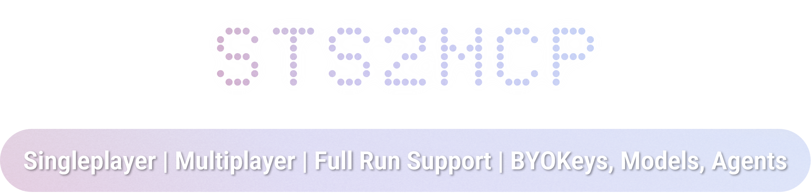

<p align="center">
  
</p>

<p align="center"><em>An Experimental Research Project to Fully-Automate your Slay the Spire 2 Runs</em></p>

A mod for [**Slay the Spire 2**](https://store.steampowered.com/app/2868840/Slay_the_Spire_2/) that lets AI agents play the game. Exposes game state and actions via a localhost REST API, with an optional MCP server for Claude Desktop / Claude Code integration.

Singleplayer and multiplayer (co-op) supported, plus full menu and lobby control: profile switching, character select (SP and MP host/client) with optional seed, multiplayer host / Steam-friend join / FastMP localhost join, multiplayer load lobby for resuming saved co-op runs, game-over dismissal, FTUE/tutorial popup handling, and Timeline visibility. Tested against STS2 `v0.113.1`.

> [!warning]
> This mod allows external programs to read and control your game via a localhost API. Use at your own risk with runs you care less about.

> [!caution]
> Multiplayer support is in **beta** — expect bugs. Any multiplayer issues encountered with this mod installed are very likely caused by the mod, not the game. Please disable the mod and verify the issue persists before reporting bugs to the STS2 developers.

## For Players

### 1. Install the Mod

1. Clone or download this repository and follow the [source build and install instructions](#build--install) for your OS. Build the mod and run the Python bridge from the same checkout so both use the same authentication protocol.
2. Launch the game and enable the mod under **Settings → Mods**. Accept the mod-loading consent dialog if it appears.
3. Return to the main menu. The mod starts the HTTP server on `localhost:15526` and logs the path to its `STS2_MCP.token` file.

Verify the installation with an authenticated state read. On Windows, the following example uses the default token path. Substitute the logged path if it differs.

```powershell
$tokenFile = Join-Path $env:APPDATA "SlayTheSpire2/STS2_MCP.token"
$token = (Get-Content -Raw -LiteralPath $tokenFile).Trim()
Invoke-RestMethod 'http://localhost:15526/api/v1/singleplayer?format=json' `
  -Headers @{ Authorization = "Bearer $token" }
```

On macOS or Linux, use the path from the game log.

```bash
TOKEN_FILE="/path/from/game/log/STS2_MCP.token"
printf 'Authorization: Bearer %s\n' "$(cat "$TOKEN_FILE")" |
  curl --fail --silent --show-error --header @- \
    'http://localhost:15526/api/v1/singleplayer?format=json'
```

Expect game state with a `state_type` field. If the token is missing, check that the source-built DLL loaded and check the game's log for the token path. HTTP 401 means the server rejected the token.

### 2. Give Your AI Instructions to Interact with the Game

From the same checkout you built above:

| I prefer a skill | I prefer an MCP Server |
|---|---|
| Tell AI to reference docs/raw-*.md. Sit back, and watch it play. | Requires [Python 3.11+](https://www.python.org/) and [uv](https://docs.astral.sh/uv/). Follow the instructions below ⬇️ |

#### MCP server setup

Install [uv](https://docs.astral.sh/uv/) if you don't have it (macOS: `brew install uv`). Then run the server once to install dependencies:

```bash
uv run --directory /path/to/STS2_MCP/mcp python server.py --help
```

`uv` reads `mcp/pyproject.toml`, creates an isolated virtual environment, and installs the pinned dependencies from `mcp/uv.lock`. Subsequent runs reuse the environment instantly.

Add the server to your AI client's MCP config:

```json
{
  "mcpServers": {
    "sts2": {
      "command": "uv",
      "args": ["run", "--directory", "/path/to/STS2_MCP/mcp", "python", "server.py"]
    }
  }
}
```

**Claude Code**: add to your project's `.mcp.json`.
**Claude Desktop**: add to `claude_desktop_config.json` with the same config as above.
*Other agents should have similar config options for custom MCP servers.*

> [!tip]
> On macOS, use the absolute path to `uv` (e.g. `/opt/homebrew/bin/uv`) in the `command` field. GUI-launched apps may not inherit your shell's `PATH`, which would prevent the server from starting.

Restart your Claude session after adding the config. To verify the MCP server is working, ask Claude to call `get_game_state` — with the game running, it should return the current game state.

The mod creates `STS2_MCP.token` in the game's per-user data directory on its first launch and logs the file path. On Windows the default is `%APPDATA%\SlayTheSpire2\STS2_MCP.token`. The MCP server reads the file on its first tool call. If the game uses a different data directory, add `--token-file` and the logged path to the MCP server's arguments.

The MCP client connects directly to loopback. Use `--host` to select `localhost` or `127.0.0.1`, and `--port` if the mod uses a custom port. Raw HTTP clients need an `Authorization: Bearer <token>` header with the token file's contents for every game API call. The `GET /` health check is available without the token. Keep the token file private.

### Profile and Compendium Data

The HTTP API exposes profile-level progress separately from live run state:

- `GET /api/v1/profile` returns the active profile's persistent progress summary, including discoveries, achievements, epochs, character totals, and global run totals.
- `GET /api/v1/compendium` groups that progress into the same high-level sections as the in-game Compendium: Card Library, Relic Collection, Potion Lab, Bestiary, Character Stats, and Run History.
- `GET /api/v1/wiki?query=...` searches discovered card and relic wiki entries for the active profile with fuzzy matching. Results are limited to 10 by default and can be overridden with `limit`; card results include base and upgraded variants when available.
- `GET /api/v1/profiles` lists the three profile slots and the active profile.
- `POST /api/v1/profiles` switches profile slots. Deleting an inactive slot requires setting `"allow_profile_delete": true` in `STS2_MCP.conf` beside the mod DLL and restarting the game.

The MCP server exposes the same profile data through `get_profile()`, `get_compendium()`, `search_wiki(query, item_type, limit)`, `list_profiles()`, `switch_profile(profile_id)`, and `delete_profile(profile_id)`.

`get_compendium()` works from the main menu and includes a `current_run` block while a run is active. It reads saved run history from the game's active profile directory and returns at most 20 entries. If the game cannot resolve an existing active save directory, file-backed run data is marked `unavailable`.

If `switch_profile()` returns `"restart_required": true`, restart the game to load the selected profile.

`search_wiki()` is the selective lookup path for durable card and relic text. It never returns the full game catalog: the mod first filters to the active profile's discovered card and relic IDs, then returns only the best fuzzy matches. Use `item_type="card"` or `item_type="relic"` when the query is known, and raise `limit` only when the default 10 results are not enough.

## For Developers

### Build & Install

Requires [.NET 9 SDK](https://dotnet.microsoft.com/download/dotnet/9.0) and the base game.

**PowerShell** (recommended):

```powershell
# Pass game path directly:
.\build.ps1 -GameDir "D:\SteamLibrary\steamapps\common\Slay the Spire 2"

# Or set it once and forget:
$env:STS2_GAME_DIR = "D:\SteamLibrary\steamapps\common\Slay the Spire 2"
.\build.ps1
```

The script builds `STS2_MCP.dll` into `out/STS2_MCP/`. Copy it along with the manifest JSON to `<game_install>/mods/` to install:

```
out/STS2_MCP/STS2_MCP.dll           ->  <game_install>/mods/STS2_MCP.dll
mod_manifest.json                   ->  <game_install>/mods/STS2_MCP.json
```

On Linux, build with the .NET SDK and use the same output and install paths.

```bash
dotnet build STS2_MCP.csproj -c Release -o out/STS2_MCP -p:STS2GameDir="/path/to/Slay the Spire 2"
```

### Build instructions for macOS

Install dotnet to compile the mod:

```bash
brew install dotnet@9
export DOTNET_ROOT="/opt/homebrew/opt/dotnet@9/libexec"
export PATH="$DOTNET_ROOT:$PATH"
```

Homebrew installs `dotnet@9` as keg-only, so the exports above are required for the current session. Add them to `~/.zshrc` to persist across sessions.

Build with `dotnet` directly (the PowerShell script is Windows-only):

```bash
dotnet build STS2_MCP.csproj -c Release -o out/STS2_MCP \
  -p:STS2GameDir="$HOME/Library/Application Support/Steam/steamapps/common/Slay the Spire 2"
```

On macOS the game ships as an app bundle. The `.csproj` detects macOS and resolves the data directory to `SlayTheSpire2.app/Contents/Resources/data_sts2_macos_arm64` automatically.

The mods directory on macOS lives inside the app bundle at `SlayTheSpire2.app/Contents/MacOS/mods/`. Finder hides bundle contents by default — to browse it in the GUI, right-click `SlayTheSpire2.app` → **Show Package Contents**. Or copy from the terminal:

```bash
GAME_DIR="$HOME/Library/Application Support/Steam/steamapps/common/Slay the Spire 2"
MODS_DIR="$GAME_DIR/SlayTheSpire2.app/Contents/MacOS/mods"
mkdir -p "$MODS_DIR"
cp out/STS2_MCP/STS2_MCP.dll "$MODS_DIR/"
cp mod_manifest.json "$MODS_DIR/STS2_MCP.json"
```

> [!NOTE] 
> `mod_manifest.json` is renamed to `STS2_MCP.json` on copy — the game's mod loader expects the manifest filename to match the mod ID.

## License

MIT

## FAQ

### Why let the AI play the game for me?

I start building this mod with the hope that I can co-op with an AI player. Singleplayer is originally just built for validation.

### You did not answer the question!

First of all, I play lots of games, including service games that has daily/weekly tasks. I really hoped that modern AI could save me from the grind, which, if you have tried one or more of the GUI agents, never really materialized. Let's face it: modern AI is still pretty bad at gaming because no one cares.

About my intention, as a researcher that loves playing games, the purpose of STS2MCP is to test AI models and agents in a rarely explored (we call it out-of-distribution) domain. Ultimately, this might turn into a benchmark for evaluating the reasoning and decision-making capabilities of different language models.

STS2 is just an example to show how good (or bad) current AI agents are at playing such games. **I have no intention to replace human players with AI, and I would definitely rather play STS2 myself** as a big fan of the game.

### Is this a cheat mod?

It can be, but it doesn't have to be. The mod itself does not alter the gameplay. It is just an interface that allows external programs to interact with the game. What you do with that interface is up to you.

### How many tokens do a run consume?

I evaluated on the Ironclad. Claude Sonnet 4.6 uses slightly more than 8M tokens (counting both input, output and tool responses) for a full run. GPT-5.4 averages 7.34M tokens. Depending on your prompt and model choice, it can be more or less.

### Do you have a roadmap for future features?

The project is still too early to have a clear roadmap. My current focus is to make sure the core features are stable and well-documented. However, I am open to suggestions and contributions from the community.

- Solidifying multiplayer features and fixing bugs is a priority
- Add support for in-game communication in multiplayer runs when collaborating with an AI agent
- Self-reflection and learning from past runs to improve future performance
- Benchmarking different models and agents is also on my mind
